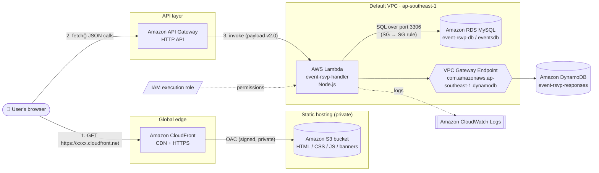
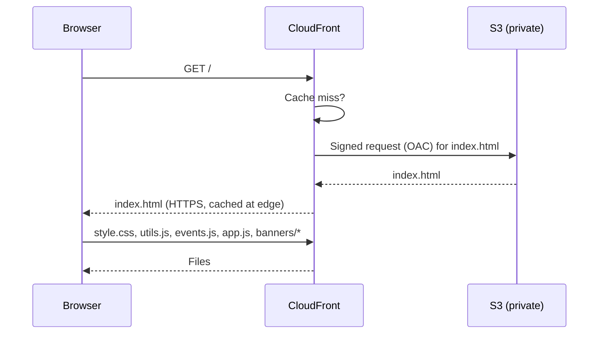
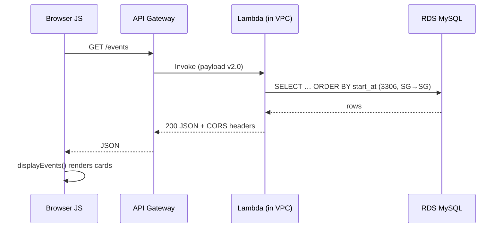
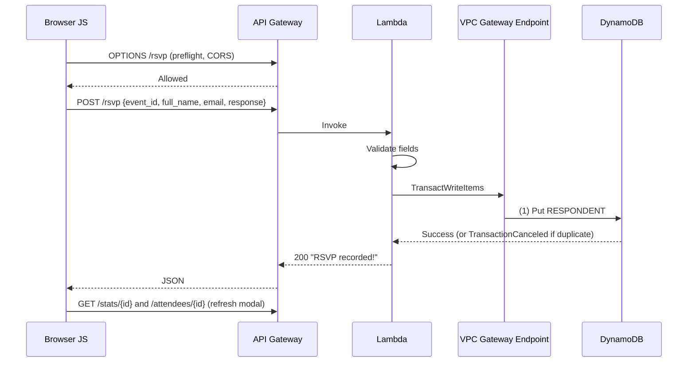

# Event RSVP — Serverless Full-Stack Application on AWS

A **serverless, full-stack event RSVP application** built on AWS. Visitors can browse upcoming events, view event details, submit an RSVP (Yes or No), and see attendance counts and attendee lists update in real time.

This repository includes the application source code and a practical guide to its AWS implementation. It documents the services used, configuration choices, and the rationale behind them.

> **Region used throughout:** `ap-southeast-1` (Asia Pacific – Singapore)

---

## Table of Contents

1. [What the app does](#1-what-the-app-does)
2. [Architecture](#2-architecture)
3. [AWS services at a glance](#3-aws-services-at-a-glance)
4. [Repository structure](#4-repository-structure)
5. [Core concepts you need first](#5-core-concepts-you-need-first)
6. [Step-by-step AWS implementation](#6-step-by-step-aws-implementation)
   - [Step 0 – Prerequisites, region and budget alarm](#step-0--prerequisites-region-and-budget-alarm)
   - [Step 1 – Amazon RDS (MySQL)](#step-1--amazon-rds-mysql--event-details)
   - [Step 2 – Amazon DynamoDB](#step-2--amazon-dynamodb--rsvp-responses-and-live-counts)
   - [Step 3 – IAM role for Lambda](#step-3--iam-role-for-lambda)
   - [Step 4 – AWS Lambda](#step-4--aws-lambda--the-backend)
   - [Step 5 – VPC endpoint for DynamoDB](#step-5--vpc-gateway-endpoint-for-dynamodb)
   - [Step 6 – Amazon API Gateway](#step-6--amazon-api-gateway-http-api)
   - [Step 7 – Test the backend](#step-7--test-the-backend-postman--curl)
   - [Step 8 – Connect and run the front end locally](#step-8--connect-and-run-the-front-end-locally)
   - [Step 9 – Amazon S3](#step-9--amazon-s3--private-hosting-bucket)
   - [Step 10 – Amazon CloudFront](#step-10--amazon-cloudfront--global-https-delivery)
   - [Step 11 – Banners and final verification](#step-11--banners-and-final-verification)
7. [Deep-dive notes on each AWS service](#7-deep-dive-notes-on-each-aws-service)
8. [Backend code walkthrough and API reference](#8-backend-code-walkthrough-and-api-reference)
9. [Request flows end to end](#9-request-flows-end-to-end)
10. [Troubleshooting guide](#10-troubleshooting-guide)
11. [Cost control, pause and cleanup](#11-cost-control-pause-and-cleanup)
12. [Security review and improvements](#12-security-review-and-improvements)
13. [Local development](#13-local-development)


---

## 1. What the app does

| Capability | Where it happens |
|---|---|
| List all upcoming events as cards (title, banner, date) | Front end → `GET /events` → Lambda → **RDS MySQL** |
| Open an event modal with full details | `GET /event/{event_id}` → **RDS** |
| Submit an RSVP (full name, email, Yes/No) | `POST /rsvp` → Lambda → **DynamoDB** (transaction) |
| Prevent the same email RSVPing twice to one event | DynamoDB **conditional write** |
| Show live Yes / No counts | `GET /stats/{event_id}` → **DynamoDB** counters |
| Show the attendee list | `GET /attendees/{event_id}` → **DynamoDB** query |

**Why two databases?** This is deliberate and the main learning goal of the project:

- **Event details** (title, description, date, venue, banner) are *structured, relational, rarely changing* → **Amazon RDS for MySQL (SQL)**.
- **RSVP responses and counters** are *write-heavy, fast-changing, key-based* → **Amazon DynamoDB (NoSQL)**.

---

## 2. Architecture

### 2.1 High-level diagram



### 2.2 Two independent layers

The app is two separate deployments that only meet in the browser:

| Layer | Services | What it serves |
|---|---|---|
| **Front end (static)** | S3 + CloudFront | `index.html`, `style.css`, `utils.js`, `events.js`, `app.js`, banner images |
| **Back end (dynamic)** | API Gateway + Lambda + RDS + DynamoDB | JSON responses |

The browser address bar shows the **CloudFront domain**. In DevTools → *Network*, the API calls go to a **different domain** (the API Gateway endpoint). That is expected: CloudFront only hands out files, it never runs backend code. Because the two domains differ, **CORS** has to be configured (see [API Gateway](#step-6--amazon-api-gateway-http-api)).

### 2.3 Data architecture

```mermaid
erDiagram
    EVENTS_MYSQL {
        varchar event_id PK
        varchar title
        text description
        datetime start_at
        varchar venue
        varchar banner_url
        timestamp created_at
    }
    DYNAMODB_ITEM_ATTENDEE {
        string pk "EVENT#event_id"
        string sp "RESPONDENT#email"
        string full_name
        string email
        string response "Yes or No"
        number timestamp
    }
    DYNAMODB_ITEM_COUNTER {
        string pk "EVENT#event_id"
        string sp "RESPONSE#Yes or RESPONSE#No"
        number count
    }
    EVENTS_MYSQL ||--o{ DYNAMODB_ITEM_ATTENDEE : "event_id (logical link)"
    EVENTS_MYSQL ||--o{ DYNAMODB_ITEM_COUNTER : "event_id (logical link)"
```

There is **no foreign key** between MySQL and DynamoDB. The shared `event_id` string is the logical link, maintained by the Lambda code.

### 2.4 Network architecture

```
                          Internet
                             │
          ┌──────────────────┼───────────────────┐
          │                  │                   │
     CloudFront        API Gateway          (My IP only)
     (public)           (public)             DBeaver
          │                  │                   │
          ▼                  ▼                   ▼
   S3 (private,        ┌─────────────── Default VPC ───────────────┐
   OAC only)           │                                           │
                       │   Lambda (ENIs in VPC subnets)            │
                       │      │ port 3306                          │
                       │      ▼  allowed by SG-to-SG rule          │
                       │   RDS MySQL  (single-AZ, ap-southeast-1b) │
                       │                                           │
                       │   Lambda ──► VPC Gateway Endpoint ──┐     │
                       └─────────────────────────────────────┼─────┘
                                                             ▼
                                                  DynamoDB (AWS public service,
                                                  reached privately via endpoint)
```

---

## 3. AWS services at a glance

| # | Service | Role in this project | Resource name / config used |
|---|---|---|---|
| 1 | **AWS Budgets** | Cost safety net | Monthly cost budget (alerts at 85 % actual, 100 % actual, 100 % forecast) |
| 2 | **Amazon RDS (MySQL)** | Stores event details | `event-rsvp-db`, DB `eventsdb`, `db.t3.micro`, single-AZ |
| 3 | **Amazon DynamoDB** | Stores RSVPs + live counters | Table `event-rsvp-responses`, keys `pk` / `sp`, on-demand |
| 4 | **AWS IAM** | Gives Lambda permissions | Execution role with basic logging + VPC access + DynamoDB access |
| 5 | **AWS Lambda** | Backend logic | `event-rsvp-handler`, Node.js (ESM), timeout 15–30 s, inside the VPC |
| 6 | **Amazon VPC** | Private network | Default VPC, subnets in the DB subnet group, security groups, **DynamoDB gateway endpoint** |
| 7 | **Amazon API Gateway** | Public HTTPS front door | HTTP API with 5 routes + CORS |
| 8 | **Amazon CloudWatch** | Logs and debugging | Lambda log group `/aws/lambda/event-rsvp-handler` |
| 9 | **Amazon S3** | Private file storage for the website | Private bucket, Block Public Access ON, `banners/` folder |
| 10 | **Amazon CloudFront** | CDN, HTTPS, public access to the private bucket | Distribution with Origin Access Control, default root object `index.html` |

---

## 4. Repository structure

```
EVENT-RSVP/
├── index.html            # Page skeleton: header, events grid, modal container
├── style.css             # Layout, cards grid, modal, stats bar, form, table styles
├── utils.js              # API_BASE_URL, apiCall() wrapper, date/time formatters, modal close
├── events.js             # fetch* API helpers, submitRSVP(), display & modal logic
├── app.js                # Entry point: loads events when the DOM is ready
├── index.js              # ⭐ Lambda handler (routing + MySQL + DynamoDB logic)
├── package.json          # Lambda dependencies (mysql2, @aws-sdk/client-dynamodb), "type": "module"
├── package-lock.json
├── rsvp-backend.zip      # Packaged Lambda deployment bundle (code + node_modules)
├── database-notes.txt    # MySQL CREATE TABLE + sample INSERT statements
├── AWS_Config/           # 📸 Screenshots of my real AWS console configuration
│   ├── RDS DB.png
│   ├── Dynamo DB.png
│   ├── IAM Roles.png
│   ├── Lambda.png
│   ├── API Gateway.png
│   ├── VPCEndPoints.png
│   ├── ec2 security groups.png
│   ├── S3 Bucket.png
│   └── CloudWatch.png
└── NOTES/                # 🗒️ Concept diagrams I drew while studying
    ├── ServerTypes.png
    ├── Architecture-WebServer.png
    ├── Architecture-Backend-Application Server.png
    ├── API.png
    ├── AWS Lambda IAM.png
    ├── RDS Availability and Durability.png
    ├── DynamoDB PK SK.png
    ├── S3 CDN.png
    └── CloudFront.png
```

**File roles**

| Side | Files | Deployed to |
|---|---|---|
| Front end | `index.html`, `style.css`, `utils.js`, `events.js`, `app.js` | S3 bucket root (served by CloudFront) |
| Back end | `index.js`, `package.json`, `node_modules/` → zipped | AWS Lambda |
| Database setup | `database-notes.txt` | Run once in a MySQL client against RDS |

> 💡 `node_modules/` and `rsvp-backend.zip` are build artifacts. For a cleaner repo, add them to `.gitignore` and regenerate with `npm install` + `zip` (see [Step 4](#step-4--aws-lambda--the-backend)).

---

## 5. Core concepts you need first

**Front end vs back end.** The front end is what the user sees and runs in the browser (HTML/CSS/JS). The back end is where logic and data live (Lambda, databases).

**CRUD.** Create / Read / Update / Delete. Mapped here: *Create* = submit an RSVP, *Read* = list events and fetch stats, *Update* = increment counters, *Delete* = (not exposed; used only manually).

**API and HTTP verbs.** The API is the bridge between front end and back end. `GET` reads, `POST` creates, `PUT` updates, `DELETE` removes. This project uses mostly `GET` and one `POST`.

**SQL vs NoSQL.** SQL = spreadsheet (fixed columns, relations, joins). NoSQL = flexible items accessed by key, built for very fast, high-volume reads and writes.

**Traditional server vs EC2 vs serverless.**

| Model | You manage | Billing | Example |
|---|---|---|---|
| Traditional server | Everything: hardware, OS, patching, power | Capex | On-prem machine |
| Virtual server | OS, runtime, patching, scaling | Per hour while running | Amazon EC2 |
| **Serverless** | Only your code | Per request / per millisecond | **AWS Lambda** |

The backend could have run on EC2 with Node.js + Express, but that means paying for idle time and managing the OS and scaling. Lambda removes all of that.

---

## 6. Step-by-step AWS implementation

> Every step lists **what to click/enter** and **why**. Replace placeholders such as `<YOUR_PASSWORD>`, `<ACCOUNT_ID>`, `<DB_ENDPOINT>` with your own values. **Never commit real passwords or account IDs.**

### Step 0 – Prerequisites, region and budget alarm

**Install locally**

| Tool | Why |
|---|---|
| Node.js (LTS) + npm | Install Lambda dependencies and package the function |
| VS Code (any editor) | Write Lambda and front-end code |
| DBeaver / MySQL Workbench | Connect to RDS to create tables and inspect data |
| Postman / Thunder Client / curl | Test API endpoints before wiring the front end |
| Git + GitHub | Version control and portfolio |
| `zip` | Create the Lambda deployment package |

**Choose one region and stay in it**

Switch the console region (top-right) to **Asia Pacific (Singapore) `ap-southeast-1`**.

*Why:* RDS, Lambda, DynamoDB, the VPC endpoint and the S3 bucket must be in the **same region**. Resources are regional, and most "I can't find my table / endpoint" mistakes come from being in the wrong region. (CloudFront and IAM are global.)

**Create a budget alarm (do this first)**

1. Console → search **Billing** → **Budgets** → **Create budget**.
2. Choose **Customized → Cost budget** (monthly). *(The "Zero spend" template alerts at $0.01 and is the strictest option.)*
3. Name it, set **Period: Monthly**, **Budget amount: 10** (USD) or lower.
4. Add your email as alert recipient.

| Alert | Meaning |
|---|---|
| Actual spend ≥ 85 % | Early warning |
| Actual spend ≥ 100 % | You hit the limit |
| **Forecasted** spend ≥ 100 % | AWS predicts you will exceed it *before it happens* |

*Why:* Cloud billing is pay-as-you-go. A forgotten RDS instance or NAT gateway is the classic surprise bill. A budget is the cheapest 5 minutes of insurance you can buy.

---

### Step 1 – Amazon RDS (MySQL) · event details

**1.1 Create the database**

Console → **RDS → Databases → Create database**.

| Option | Value | Why this choice |
|---|---|---|
| Creation method | **Standard create** | Exposes every setting so you learn what each does |
| Engine | **MySQL** | Relational/SQL fits structured event data; `mysql2` is a first-class Node driver |
| Template | **Free tier** (Sandbox/dev) | Cheapest; presets the safe small-scale options. Real companies use *Dev/Test* or *Production* templates |
| Availability & durability | **Single-AZ DB instance** | One copy in one data center. Multi-AZ keeps a standby copy in another AZ (99.99 % uptime, automatic failover) but **costs roughly double**. A demo does not need it |
| DB instance identifier | `event-rsvp-db` | Name of the instance (not the database inside it) |
| Master username | `admin` | Admin login |
| Master password | `<YOUR_PASSWORD>` | Remember it; it goes into a Lambda environment variable |
| Instance class | **`db.t3.micro`** | See breakdown below |
| Compute resource | **Don't connect to an EC2 compute resource** | We connect from Lambda manually and control the security groups ourselves |
| Network type | IPv4 | Default |
| VPC | **Default VPC** | No extra setup; AWS auto-creates a DB subnet group from its subnets |
| DB subnet group | `default-vpc-…` (auto) | The list of subnets (one per AZ) RDS may place the DB in |
| Public access | **Yes** *(temporarily)* | Lets DBeaver on my laptop connect. Should be switched to **No** once setup is done (see [Security review](#12-security-review-and-improvements)) |
| VPC security group | **Choose existing → `default`** | Reused so Lambda and RDS can share rules |
| Availability Zone | No preference (landed in `ap-southeast-1b`) | Single-AZ, so only one is used |
| **Additional configuration → Initial database name** | **`eventsdb`** | ⚠️ Easy to miss. Without it, RDS creates the server but **no database** inside it |

**Reading the instance class `db.t3.micro`**

| Part | Meaning |
|---|---|
| `db` | A database instance (RDS), not an EC2 instance |
| `t3` | Instance **family** — **T** = *burstable performance* |
| `micro` | Size — the smallest: 2 vCPU, 1 GiB RAM |

*Burstable* = the instance runs on a low CPU baseline and builds up credits, then **bursts** to full CPU when load spikes (e.g. 100 people RSVP at once). That matches this app's tiny, spiky workload. Bigger families (`m5`, `r6g`) cost much more and are for sustained heavy workloads.

**1.2 Understand the networking terms (they trip up beginners)**

| Term | Analogy | Meaning |
|---|---|---|
| **VPC** | A gated subdivision in the AWS city | Your private network; defines which resources can talk and how |
| **Subnet** | A street inside the subdivision | A slice of the VPC tied to **one** Availability Zone |
| **DB subnet group** | Streets where the DB is allowed to live | Subnets RDS may use (needs ≥ 2 AZs) |
| **Availability Zone** | A building | One physical data center in a region |
| **Security group** | A guard at each house's gate | A **stateful firewall** with allow-rules (inbound/outbound) |

**1.3 Verify after status = Available**

- *Publicly accessible* = **Yes**
- Note the **Endpoint** (`event-rsvp-db.<id>.ap-southeast-1.rds.amazonaws.com`) and port **3306**
- Note the attached **VPC security group** (`default`)

**1.4 Edit the security group's inbound rules**

RDS → *VPC security groups* → **Inbound rules → Edit**.

| Type | Port | Source | Purpose |
|---|---|---|---|
| MySQL/Aurora | 3306 | **My IP** | So *I* can connect with DBeaver |
| MySQL/Aurora | 3306 | **The security group's own ID** (`sg-xxxxxxxx`) | So **Lambda can connect to RDS** (added in [Step 4](#step-4--aws-lambda--the-backend)) |

- **Source = My IP** means only my current public IP may reach port 3306.
- **Never** open 3306 to `0.0.0.0/0` (the whole internet).
- *Why the second rule is needed:* attaching the **same** security group to both Lambda and RDS does **not** make them trust each other. Security groups only allow traffic that an explicit rule permits. A rule whose **source is the group itself** says "anything wearing this group may talk to anything else wearing this group on 3306".

**1.5 Connect with DBeaver and create the schema**

1. New connection → **MySQL**.
2. Host = RDS endpoint, Port = `3306`, Database = `eventsdb`, user `admin` + password.
3. **Test connection** → *Connected*.
4. Run the script from [`database-notes.txt`](database-notes.txt):

```sql
CREATE TABLE events (
  event_id    VARCHAR(64)  PRIMARY KEY,
  title       VARCHAR(200) NOT NULL,
  description TEXT,
  start_at    DATETIME     NOT NULL,
  venue       VARCHAR(200),
  banner_url  VARCHAR(500),
  created_at  TIMESTAMP    DEFAULT CURRENT_TIMESTAMP
);
```

| Column | Type | Reason |
|---|---|---|
| `event_id` | `VARCHAR(64)` **PRIMARY KEY** | Human-readable slug (e.g. `aws-meetup-manila-2025`) used in URLs and as the DynamoDB link |
| `title` | `VARCHAR(200) NOT NULL` | Every event needs a title |
| `description` | `TEXT` | Long free-form text |
| `start_at` | `DATETIME NOT NULL` | Event date + time; used by `ORDER BY start_at` |
| `venue` | `VARCHAR(200)` | Optional location |
| `banner_url` | `VARCHAR(500)` | URL to the banner in S3/CloudFront (filled later) |
| `created_at` | `TIMESTAMP DEFAULT CURRENT_TIMESTAMP` | Auto audit field — when the row was inserted |

5. Insert the sample rows (also in `database-notes.txt`), leaving `banner_url` as `''` for now, then `SELECT * FROM events;` to confirm.

**If the connection fails, check in this order:** correct region → *Publicly accessible = Yes* → security group allows **my current IP** → database name is present in the connection settings.

> ⏸️ **Cost tip:** if you will not touch the project for a few days, **Stop** (not delete) the RDS instance. Compute billing pauses; storage is kept. (AWS automatically restarts a stopped instance after 7 days.)

> ℹ️ No `attendees` table exists on purpose. RSVPs live in DynamoDB.

---

### Step 2 – Amazon DynamoDB · RSVP responses and live counts

Console → **DynamoDB → Tables → Create table**.

| Option | Value | Why |
|---|---|---|
| Table name | `event-rsvp-responses` | Hard-coded in `index.js` — must match exactly |
| Partition key | **`pk`** (String) | Groups all items for one event ("the folder") |
| Sort key | **`sp`** (String) | Distinguishes items inside that folder ("the file name") |
| Table settings | Default / **On-demand** capacity | Pay per request, no capacity planning, near-zero cost for tiny traffic |
| Deletion protection | Off (demo) | Turn on for anything real |

> 📝 The video names the keys `PK`/`SK`. **My implementation uses `pk` and `sp`**, and `index.js` references `pk` / `sp`. Key names are case-sensitive; whatever you pick in the console must match the code.

**The single-table design**

DynamoDB has no joins, so you **model the table around the questions you will ask**:

1. *"Who responded to event X?"*
2. *"How many Yes / No for event X?"*
3. *"Has this email already responded to event X?"*

One table holds two kinds of items for each event, sharing the same `pk`:

| Item type | `pk` | `sp` | Other attributes |
|---|---|---|---|
| **Attendee record** | `EVENT#<event_id>` | `RESPONDENT#<email>` | `full_name`, `email`, `response`, `timestamp` |
| **Counter record** | `EVENT#<event_id>` | `RESPONSE#Yes` or `RESPONSE#No` | `count` (Number) |

Example for event `aws-meetup-manila-2025`:

| pk | sp | attributes |
|---|---|---|
| `EVENT#aws-meetup-manila-2025` | `RESPONDENT#darla@example.com` | full_name = Darla, response = Yes, timestamp = 1730000000000 |
| `EVENT#aws-meetup-manila-2025` | `RESPONDENT#john@example.com` | full_name = John Doe, response = No, … |
| `EVENT#aws-meetup-manila-2025` | `RESPONSE#Yes` | count = 1 |
| `EVENT#aws-meetup-manila-2025` | `RESPONSE#No` | count = 1 |

**How the access patterns map to queries**

| Question | DynamoDB operation |
|---|---|
| All attendees of an event | `Query pk = EVENT#id AND begins_with(sp, "RESPONDENT#")` |
| Live counts | `Query pk = EVENT#id AND begins_with(sp, "RESPONSE#")` |
| Prevent duplicate RSVP | `Put` with `ConditionExpression: attribute_not_exists(sp)` on `RESPONDENT#email` |

Do **not** add items by hand; the Lambda creates them on the first RSVP. DynamoDB is schemaless (apart from the key), so different items in the same table can have different attributes — that is why attendee and counter items can coexist.

---

### Step 3 – IAM role for Lambda

A **role** is an identity with a set of permissions that an AWS service can *assume*. Think of an ID badge listing which rooms you may enter. By default Lambda can only run code and write nothing else.

When creating the function with *"Create a new role with basic Lambda permissions"*, AWS creates a role such as `event-rsvp-handler-role-xxxxxxxx` with **`AWSLambdaBasicExecutionRole`** (write logs to CloudWatch). Then **add two more managed policies**:

Lambda → **Configuration → Permissions → click the role name → Add permissions → Attach policies**

| Policy | Why Lambda needs it |
|---|---|
| `AWSLambdaVPCAccessExecutionRole` (search "AWSLambdaVPC") | Lets Lambda **create and manage network interfaces (ENIs)** inside your VPC so it can reach RDS. Without it you can't attach Lambda to a VPC |
| `AmazonDynamoDBFullAccess` | Lets Lambda read/write the RSVP table |

**Least-privilege alternative** (recommended once things work) — replace `AmazonDynamoDBFullAccess` with a custom policy scoped to one table and only the actions the code uses (`TransactWriteItems` requires `PutItem` and `UpdateItem` on the table):

```json
{
  "Version": "2012-10-17",
  "Statement": [
    {
      "Sid": "RsvpTableAccess",
      "Effect": "Allow",
      "Action": [
        "dynamodb:PutItem",
        "dynamodb:UpdateItem",
        "dynamodb:Query"
      ],
      "Resource": "arn:aws:dynamodb:ap-southeast-1:<ACCOUNT_ID>:table/event-rsvp-responses"
    }
  ]
}
```

*Why roles matter:* if a function is ever compromised, it can only do what its role allows — "a house key for the gate, not the bedroom or the safe."

---

### Step 4 – AWS Lambda · the backend

**4.1 Create the function**

Console → **Lambda → Create function → Author from scratch**

| Option | Value | Why |
|---|---|---|
| Function name | `event-rsvp-handler` | |
| Runtime | **Node.js** (current LTS, e.g. 22.x) | Matches the JavaScript code |
| Architecture | `x86_64` (default) | `mysql2` is pure JavaScript, so `arm64` would also work and is slightly cheaper |
| Execution role | **Create a new role with basic Lambda permissions** | Gives CloudWatch logging; other permissions added in Step 3 |

**4.2 General configuration**

Configuration → **General configuration → Edit**

| Setting | Value | Why |
|---|---|---|
| Timeout | **15–30 seconds** | Default is **3 s**, too short for the first connection to RDS inside a VPC (cold start + ENI + TCP + auth) → "Task timed out" |
| Memory | 128 MB default is fine to start | More memory also means more CPU; raise if slow |

**4.3 Environment variables**

Configuration → **Environment variables → Edit**

| Key | Value | Used by |
|---|---|---|
| `DB_HOST` | RDS endpoint | `mysql.createConnection` |
| `DB_USER` | `admin` | |
| `DB_PASS` | `<YOUR_PASSWORD>` | |
| `DB_NAME` | `eventsdb` | |
| `REGION` | `ap-southeast-1` | `new DynamoDBClient({ region: process.env.REGION })` |

*Why env vars:* no secrets hard-coded in source. (Production upgrade: **AWS Secrets Manager**.) The name `REGION` is used because Lambda reserves `AWS_REGION` for itself.

**4.4 Attach the function to the VPC**

Configuration → **VPC → Edit**

- VPC: the **same VPC as RDS** (default VPC)
- Subnets: the **same subnets** as the DB subnet group (select at least two for availability)
- Security group: the **same group as RDS** (`default`)

*Why:* RDS lives *inside* the VPC and (ideally) is private. A Lambda is outside any VPC by default and cannot reach it. Attaching the Lambda places elastic network interfaces in your subnets so it becomes a "neighbour" of the database.

⚠️ **Trade-off you will hit in Step 5:** once Lambda is inside the VPC it **loses default internet access**. That breaks DynamoDB (a public AWS service) until you add a VPC endpoint.

**4.5 Allow Lambda → RDS in the security group**

Add the inbound rule from [Step 1.4](#step-1--amazon-rds-mysql--event-details): *MySQL/Aurora, 3306, source = the same security group ID*. Without it, calls to `/events` **time out** even though both resources "share" the group.

**4.6 Package the code (why you need Node.js locally)**

Pasting code directly into the Lambda editor works only for code with **no external packages**. This function needs `mysql2`. Without it you get:

```
Error: Cannot find package 'mysql2' imported from /var/task/index.mjs
```

So build a bundle locally:

```bash
# in the project folder containing index.js and package.json
npm install                       # reads package.json, creates node_modules/ and package-lock.json
zip -r rsvp-backend.zip .         # NOTE the trailing dot: include everything in this folder
```

| File | Purpose |
|---|---|
| `index.js` | The Lambda code |
| `package.json` | "Recipe card": project name, `"type": "module"` (enables `import` syntax), dependencies |
| `package-lock.json` | Exact versions installed |
| `node_modules/` | The downloaded "groceries" (mysql2 etc.) |

Upload: Lambda → **Code → Upload from → .zip file → `rsvp-backend.zip` → Save**.

> 🔎 Notes: Node.js 18+ Lambda runtimes already include AWS SDK v3, so only `mysql2` strictly needs bundling. Direct zip upload is limited to 50 MB (250 MB unzipped).

**4.7 Verify the handler setting**

Code → **Runtime settings → Edit** → **Handler = `index.handler`** (`<file name>.<exported function>`). If your file name differs, update this.

**4.8 Editing later**

For a tiny fix (e.g. a typo in a table name) edit directly in the Lambda console and **Deploy**. If you add a dependency, redo `npm install` + zip + upload.

---

### Step 5 – VPC gateway endpoint for DynamoDB

**The problem**

| Lambda placement | Can reach RDS? | Can reach DynamoDB? |
|---|---|---|
| Outside VPC | ❌ (RDS is in the private network) | ✅ (DynamoDB has a public AWS endpoint) |
| **Inside VPC** | ✅ | ❌ (no route to the internet) |

Our single Lambda needs **both**. `POST /rsvp` fails (timeout / network error) while `GET /events` works — that is the symptom.

**Two solutions**

| Option | How | Cost |
|---|---|---|
| NAT Gateway | Gives private subnets outbound internet | **~$0.045/hr + data** → expensive for a demo |
| **VPC Gateway Endpoint** ✅ | Private route from the VPC straight to DynamoDB over the AWS network | **Free** |

**Create the endpoint**

Console → **VPC → Endpoints → Create endpoint**

| Option | Value |
|---|---|
| Type | **AWS services** |
| Service | `com.amazonaws.ap-southeast-1.dynamodb` — type **Gateway** (⚠️ confirm the region prefix) |
| VPC | The same VPC the Lambda uses |
| Route tables | Select the route table(s) of the Lambda's subnets (adds a route to DynamoDB via the endpoint) |
| Policy | **Full access** (default) |

*Why Gateway type:* DynamoDB and S3 support free **gateway endpoints** that work by adding entries to route tables. Other services use paid *interface endpoints*.

*Why DynamoDB is "public" and RDS is "private":* DynamoDB is a **fully managed, serverless** service — AWS secures it at the infrastructure level and you control access only through IAM. RDS is a database *you* configure (versions, users, network placement), so it sits in *your* VPC.

> CloudWatch logging keeps working without any endpoint: Lambda delivers logs through the Lambda service itself, not through your VPC network.

---

### Step 6 – Amazon API Gateway (HTTP API)

API Gateway is the **reception desk**: it receives HTTPS requests from browsers, matches them to a route, and forwards them to Lambda.

**6.1 Create the API**

Console → **API Gateway → Create API → HTTP API → Build**

| Option | Value | Why |
|---|---|---|
| API name | `event-rsvp-api` | |
| Integration | **Lambda** → `event-rsvp-handler` (`ap-southeast-1`) | The target backend |
| Payload format | **2.0** (default for HTTP APIs) | The code reads `event.requestContext.http.method/path`, which is the v2.0 shape (v1.0 uses `event.httpMethod`) |
| Stage | `$default` with **auto-deploy** | Gives a clean URL with no `/prod` prefix; changes go live automatically |

*Why HTTP API instead of REST API:* cheaper, lower latency, simpler, and has built-in CORS. REST APIs add features (API keys, usage plans, request validation, WAF integration) not needed here.

**6.2 Routes**

| Method | Route | Purpose |
|---|---|---|
| `GET` | `/events` | List all events |
| `GET` | `/event/{event_id}` | One event's details |
| `POST` | `/rsvp` | Submit an RSVP |
| `GET` | `/stats/{event_id}` | Yes/No counts |
| `GET` | `/attendees/{event_id}` | Attendee list |

`{event_id}` is a **path parameter** (a wildcard segment). Note `/events` (list) vs `/event/{event_id}` (single) — a classic typo trap; the handler tests `path.startsWith("/event/")`, which does *not* match `/events`.

All five routes integrate with the **same** Lambda; the Lambda performs its own internal routing. The console automatically adds a **resource-based policy** on the Lambda allowing `apigateway.amazonaws.com` to invoke it.

**6.3 Configure CORS**

API → **CORS → Configure**

| Setting | Value (dev) | Meaning |
|---|---|---|
| Access-Control-Allow-Origin | `*` | Which website origins may call the API |
| Access-Control-Allow-Methods | `GET, POST, OPTIONS` (or `*`) | Allowed HTTP verbs |
| Access-Control-Allow-Headers | `content-type, authorization, x-amz-date, x-api-key, x-amz-security-token` | Headers the browser may send |

*What CORS is:* browsers block JavaScript on origin A (CloudFront) from reading responses from origin B (API Gateway) unless B says it is allowed. CORS is the **bouncer checking IDs**. Before a `POST` with JSON the browser sends an `OPTIONS` **preflight** request ("am I allowed to do this?").

*Tighten for production:* set Allow-Origin to your exact CloudFront URL/custom domain instead of `*`.

If the browser shows **"Failed to fetch"** while Postman works, the cause is almost always CORS or a wrong `API_BASE_URL`.

**6.4 Copy the Invoke URL**

API → **Stages / API details → Invoke URL**, e.g. `https://abc123.execute-api.ap-southeast-1.amazonaws.com`. This goes into `utils.js` as `API_BASE_URL`.

---

### Step 7 – Test the backend (Postman / curl)

Replace `$API` with your invoke URL.

```bash
API="https://<api-id>.execute-api.ap-southeast-1.amazonaws.com"

# 1) List events (RDS)
curl "$API/events"

# 2) One event (RDS)
curl "$API/event/aws-meetup-manila-2025"

# 3) Submit an RSVP (DynamoDB transaction)
curl -X POST "$API/rsvp" \
  -H "Content-Type: application/json" \
  -d '{"event_id":"aws-meetup-manila-2025","full_name":"Darla Davidid","email":"darla@example.com","response":"Yes"}'

# 4) Live counts (DynamoDB)
curl "$API/stats/aws-meetup-manila-2025"

# 5) Attendees (DynamoDB)
curl "$API/attendees/aws-meetup-manila-2025"
curl "$API/attendees/aws-meetup-manila-2025?response=Yes"   # optional filter
```

**Test checklist and expected results**

| Test | Expected |
|---|---|
| `GET /events` | JSON array of events ordered by `start_at` |
| `GET /event/<valid id>` | One JSON object |
| `GET /event/<bad id>` | `404 {"message":"Event not found"}` |
| `POST /rsvp` valid | `200 {"message":"RSVP recorded!"}` and **two** new DynamoDB items (attendee + counter) from one request |
| `POST /rsvp` same email + same event again | **Rejected** (conditional check fails, transaction cancelled) |
| `POST /rsvp` missing field | `400 Missing fields…` |
| `GET /stats/<id>` | `{"Yes":n,"No":m}` (zeros if no RSVPs) |

**Payload vs body:** the *request/payload* is the whole HTTP package (method, URL, headers, body); the *body* is just the JSON data inside it.

**If something fails, go to CloudWatch first:** CloudWatch → **Log groups → `/aws/lambda/event-rsvp-handler`** → latest log stream. The handler logs `Received event:` with the full JSON, so you can see exactly what API Gateway delivered (`requestContext.http.method`, `path`, `pathParameters`, `body`).

---

### Step 8 – Connect and run the front end locally

1. Open `utils.js` and set:

   ```js
   const API_BASE_URL = 'https://<your-api-id>.execute-api.ap-southeast-1.amazonaws.com';
   ```

2. Serve the folder locally (any static server), e.g.:

   ```bash
   python3 -m http.server 8000
   # open http://localhost:8000
   ```

3. Open DevTools → **Network** and confirm calls to `/events`, `/event/…`, `/stats/…`, `/attendees/…` and `/rsvp` succeed.

Local hosting = only your computer serves the files; when the laptop closes, the site disappears. The next steps put the files on AWS so anyone can reach them.

---

### Step 9 – Amazon S3 · private hosting bucket

S3 (Simple Storage Service) is object storage — like Google Drive for applications.

Console → **S3 → Create bucket**

| Option | Value | Why |
|---|---|---|
| Region | `ap-southeast-1` | Same region as everything else |
| Bucket name | Globally unique, e.g. `event-rsvp-<yourname>-site` | Names are unique across all AWS accounts |
| Object ownership | ACLs disabled (default) | Modern recommended setting |
| **Block all public access** | ✅ **ON (all four boxes)** | **The bucket stays private.** CloudFront will be the only public entrance |
| Versioning | Optional | Useful to roll back a bad deploy |
| Default encryption | SSE-S3 (default) | Free encryption at rest |

Upload:

- `index.html`, `style.css`, `utils.js`, `events.js`, `app.js` into the **bucket root**
- Create a folder `banners/` and upload banner images there

*Do not* upload `index.js`, `package.json`, `node_modules`, `rsvp-backend.zip` or `database-notes.txt` — those are backend/dev files, not website files.

---

### Step 10 – Amazon CloudFront · global HTTPS delivery

CloudFront is a **Content Delivery Network (CDN)**: it caches copies of your files in "edge locations" worldwide and serves each visitor from the nearest one.

Console → **CloudFront → Create distribution**

| Option | Value | Why |
|---|---|---|
| Origin domain | Your S3 bucket (the S3 REST endpoint, **not** a website endpoint) | The source of the files |
| Origin access | **Origin access control (OAC)** — "Allow private S3 bucket access to CloudFront" | CloudFront signs its requests to S3; the bucket stays private |
| Settings | **Recommended defaults** | Sensible cache and protocol settings |
| Viewer protocol policy | Redirect HTTP → HTTPS | Free HTTPS on `*.cloudfront.net` |
| WAF | Not enabled (demo) | Recommended for real projects |
| Default root object | **`index.html`** (set in *General → Settings → Edit*) | See below |

**Bucket policy (CloudFront offers a "Copy policy" button after creation)**

S3 → bucket → **Permissions → Bucket policy**:

```json
{
  "Version": "2012-10-17",
  "Statement": [
    {
      "Sid": "AllowCloudFrontServicePrincipalReadOnly",
      "Effect": "Allow",
      "Principal": { "Service": "cloudfront.amazonaws.com" },
      "Action": "s3:GetObject",
      "Resource": "arn:aws:s3:::<BUCKET_NAME>/*",
      "Condition": {
        "StringEquals": {
          "AWS:SourceArn": "arn:aws:cloudfront::<ACCOUNT_ID>:distribution/<DISTRIBUTION_ID>"
        }
      }
    }
  ]
}
```

This says: *"Only this one CloudFront distribution may read objects."* → website is public, bucket is not.

**Why the default root object matters**

Without it, visiting `https://xxxx.cloudfront.net/` has no file to serve (you would have to type `/index.html`). Setting **`index.html`** makes the bare domain work.

**Wait** for the distribution status to change from *Deploying* to *Enabled* (a few minutes).

---

### Step 11 – Banners and final verification

1. Copy the **distribution domain name** (`dxxxxxxxxxxxx.cloudfront.net`).
2. In DBeaver update each event (note the **`https://`**):

   ```sql
   UPDATE events
   SET banner_url = 'https://<DISTRIBUTION_DOMAIN>/banners/<file-name>.jpg'
   WHERE event_id = 'aws-buildercards-tournament-2025';
   ```

3. Refresh the site; banners now load from CloudFront/S3.
4. Final test through the public URL:
   - Event cards render ✅
   - Click a card → modal with details ✅
   - Submit an RSVP → *"RSVP submitted successfully!"* and counts + attendee list refresh ✅
   - Submit again with the same email → rejected ✅
   - DevTools → Network shows API calls going to the **API Gateway** domain ✅

After you change front-end files in S3, CloudFront may keep serving the old cached copy. Either wait for the TTL or create an **invalidation**:

```bash
aws cloudfront create-invalidation --distribution-id <ID> --paths "/*"
```

---

## 7. Deep-dive notes on each AWS service

### 7.1 AWS Lambda

**What it is.** A function-as-a-service compute platform. You upload code; AWS runs it in a short-lived execution environment on demand, scales it automatically (even to zero), and bills **per invocation and per millisecond of duration × memory**.

**Execution model**
- **Event-driven:** something *triggers* it. Here: API Gateway.
- **Handler:** the entry point (`index.handler`). It receives an `event` (the request details) and `context`.
- **Cold start vs warm:** the first invocation after idle must create an environment (download code, start runtime, run top-level code). Later invocations reuse it. VPC-attached functions use shared **Hyperplane ENIs**, so cold-start penalty today is small, but the first RDS connection still takes noticeably longer than 3 s in some cases → raise the timeout.
- **Stateless:** don't depend on local memory/disk between invocations.

**Key configuration knobs**

| Setting | Why it matters here |
|---|---|
| Timeout (default 3 s) | Raised to 15–30 s for RDS connection setup |
| Memory (default 128 MB) | Also scales CPU share |
| Environment variables | DB credentials & region (encrypted at rest) |
| Execution role | What the function may call (logs, VPC ENIs, DynamoDB) |
| VPC config | Needed to reach RDS; removes default internet access |
| Handler | Must equal `<file>.<export>` |
| Concurrency | Default account limit (1000) is plenty |

**Limits worth knowing:** 15-minute max timeout; 10 GB max memory; 50 MB zipped / 250 MB unzipped package (direct upload).

**Pricing:** free tier includes 1 M requests and 400,000 GB-seconds per month (always free). With no traffic, no cost.

**Design in this project.** One function, multiple routes (a "monolithic Lambda" / Lambda-lith). Simple to learn and deploy. Alternatives: one Lambda per route (finer permissions and scaling), or Express/Fastify behind `aws-serverless-express`.

**Connection handling.** The code opens a **new MySQL connection per invocation** and closes it in `finally`. That is safe (no leaked connections) but at scale many concurrent Lambdas can exhaust MySQL's `max_connections`. The production answer is **Amazon RDS Proxy** (connection pooling).

---

### 7.2 Amazon API Gateway (HTTP API)

**What it is.** A managed service for creating, publishing and securing APIs. It terminates TLS, routes by method+path, can throttle, authorize, and transform, and then invokes a backend (Lambda here).

**HTTP API vs REST API vs WebSocket API**

| | HTTP API ✅ | REST API | WebSocket API |
|---|---|---|---|
| Price | Lowest (~70 % cheaper) | Higher | Per message/minute |
| Latency | Lowest | Higher | — |
| Built-in CORS | Yes | Manual | — |
| Features | JWT/IAM/Lambda authorizers, throttling | + API keys, usage plans, caching, request validation, WAF | Real-time two-way |

**Key concepts**

| Concept | In this project |
|---|---|
| **Route** | `METHOD /path` → integration (`GET /events`, `POST /rsvp`, …) |
| **Integration** | Lambda proxy integration to `event-rsvp-handler` |
| **Payload format 2.0** | Request delivered as `requestContext.http.method`, `rawPath`, `pathParameters`, `queryStringParameters`, `body` |
| **Stage** | `$default`, auto-deployed |
| **CORS configuration** | Origins/methods/headers allowed by browsers. When API-level CORS is configured, API Gateway handles the `OPTIONS` preflight itself and ignores CORS headers coming back from the integration |
| **Path parameter** | `{event_id}` captured into `event.pathParameters` |

**Security posture today:** the API is **open to the internet with no authorizer**. Anyone with the URL can call every route, including `POST /rsvp`. See [Security review](#12-security-review-and-improvements).

---

### 7.3 Amazon RDS (MySQL)

**What it is.** A managed relational database service. AWS handles provisioning, OS and engine patching, automated backups, monitoring and (optionally) failover — you handle schema, queries and access control.

**Terminology**

| Term | Meaning |
|---|---|
| DB instance | The compute+storage unit running the engine (`event-rsvp-db`) |
| DB name | A database inside the instance (`eventsdb`) |
| Endpoint | DNS name you connect to (stable even if the underlying host changes) |
| Instance class | CPU/RAM size (`db.t3.micro`) |
| DB subnet group | Subnets in ≥ 2 AZs where RDS may place the instance |
| Security group | Firewall for port 3306 |
| Parameter/option groups | Engine configuration (defaults used) |

**Availability and durability (see `NOTES/RDS Availability and Durability.png`)**

| Deployment | Behaviour | Cost |
|---|---|---|
| **Single-AZ** ✅ (used) | One instance in one AZ. If the AZ has an outage, the DB is unavailable until restored | 1× |
| **Multi-AZ** | Synchronous standby copy in another AZ, automatic failover, ~99.99 % availability | ~2× |

**Storage and backups.** Data lives on EBS-backed storage. Automated backups and manual **snapshots** are available; a *stopped* instance keeps its storage (and storage still bills).

**Stop vs delete.** *Stop* pauses compute billing (up to 7 days at a time) and keeps data. *Delete* removes the instance; take a **final snapshot** first if you want to restore.

**When SQL is the right choice.** Data with well-defined structure and relationships, complex queries/joins/filters (e.g. "events after a date ordered by date"). It can struggle when huge numbers of clients update the *same row* simultaneously — which is exactly why RSVP counters are *not* kept here.

---

### 7.4 Amazon DynamoDB

**What it is.** A fully managed, serverless **key-value / document NoSQL** database with single-digit-millisecond latency at any scale. No servers, patching, or capacity planning (in on-demand mode).

**Core concepts**

| Concept | Meaning | This project |
|---|---|---|
| Table | Collection of items | `event-rsvp-responses` |
| Item | A row (up to 400 KB) | An attendee or a counter |
| Attribute | A field; schemaless | `full_name`, `response`, `count`… |
| **Partition key (`pk`)** | Decides which physical partition stores the item; must be supplied for efficient queries | `EVENT#<event_id>` |
| **Sort key (`sp`)** | Orders items inside one partition and enables range queries (`begins_with`, `between`) | `RESPONDENT#email`, `RESPONSE#Yes/No` |
| Primary key | `pk` + `sp` together must be **unique** | Gives free duplicate detection |
| Capacity mode | On-demand vs provisioned | On-demand |

**Why `pk` = folder, `sp` = file name.** All items with the same `pk` live together; `Query` fetches them in one efficient call; the `sp` prefix (`RESPONDENT#` vs `RESPONSE#`) is like sub-folders so you can pull just attendees or just counters.

**Single-table design.** Instead of separate Attendees and Counters tables, one table is modelled around access patterns. Benefits: one round trip, one set of permissions, one table to manage. Trade-off: less intuitive; every query must be planned in advance (DynamoDB cannot join).

**Atomic counters.** `UpdateExpression: "ADD #count :one"` increments server-side and creates the attribute at `1` if the item doesn't exist yet. No read-modify-write race, so thousands of simultaneous RSVPs are counted correctly. This is the key advantage over doing `UPDATE … SET count = count + 1` on a hot MySQL row.

**Transactions.** `TransactWriteItems` writes **two items atomically** — *all or nothing*:
1. `Put` attendee item with `ConditionExpression: attribute_not_exists(sp)` (fails if that email already RSVPed to that event)
2. `Update` the Yes/No counter (`ADD count 1`)

If the condition fails, *neither* write happens, so counts can never drift from the attendee list. (Transactions cost 2× the normal write capacity units.)

**Consistency.** `Query` on `RESPONSE#` uses `ConsistentRead: true` so the live count right after an RSVP is never stale.

**Why it's cheap.** On-demand has no hourly charge; a free tier covers 25 GB of storage and a generous request allowance. Idle table ≈ $0.

**Public service vs VPC.** DynamoDB is accessed over a public AWS endpoint and secured by IAM. A VPC-attached Lambda reaches it privately via the **gateway endpoint** (see [Step 5](#step-5--vpc-gateway-endpoint-for-dynamodb)).

---

### 7.5 AWS IAM

**What it is.** The permission system for all of AWS: *who* (principal) may do *what* (actions) on *which* resources, under *which* conditions.

| Concept | Explanation |
|---|---|
| **Role** | An identity *assumed* by a service/person; no long-term password or keys |
| **Trust policy** | Who may assume the role (here: `lambda.amazonaws.com`) |
| **Permissions policy** | What the role may do (managed or inline) |
| **Managed policy** | Reusable AWS- or customer-defined policy |
| **Resource-based policy** | Attached to a resource to grant others access — e.g. the Lambda permission letting API Gateway invoke it, and the S3 bucket policy letting CloudFront read |
| **Least privilege** | Grant only what's needed |

**Roles/policies in this project**

| Policy | Attached to | Effect |
|---|---|---|
| `AWSLambdaBasicExecutionRole` | Lambda role | `logs:CreateLogGroup/Stream`, `PutLogEvents` |
| `AWSLambdaVPCAccessExecutionRole` | Lambda role | `ec2:CreateNetworkInterface`, `DescribeNetworkInterfaces`, `DeleteNetworkInterface` |
| `AmazonDynamoDBFullAccess` *(or custom least-privilege)* | Lambda role | DynamoDB read/write |
| Lambda resource policy | Lambda function | Lets API Gateway invoke |
| S3 bucket policy | S3 bucket | Lets one CloudFront distribution read objects |

---

### 7.6 Amazon VPC (network, security groups, endpoints)

| Component | What it does here |
|---|---|
| **VPC** | Private address space containing RDS and Lambda ENIs |
| **Subnets** | One per AZ; RDS and Lambda are placed in them |
| **Route tables** | Decide where traffic from a subnet goes. The DynamoDB gateway endpoint adds a managed route here |
| **Internet gateway** | Gives public subnets internet access (this is how DBeaver reaches the public RDS) |
| **Security groups** | Stateful, allow-only firewalls attached to ENIs. Return traffic is automatically allowed |
| **Gateway endpoint (DynamoDB)** | Private path to DynamoDB; free |
| **NAT Gateway** *(not used)* | Alternative for outbound internet from private subnets; costly |

**Security-group rules in this project**

| Resource | Direction | Rule | Why |
|---|---|---|---|
| RDS SG | Inbound | 3306 from **My IP** | DBeaver access |
| RDS SG | Inbound | 3306 from **itself (SG→SG)** | Lambda → RDS |
| Lambda/RDS SG | Outbound | All (default) | Lets Lambda initiate connections |

**Costs.** VPCs, subnets, security groups and gateway endpoints are free. You pay for what *runs* inside them (RDS, EC2, NAT Gateway). The VPC can be kept for future projects.

---

### 7.7 Amazon S3

**What it is.** Object storage: buckets contain objects (files) identified by keys (e.g. `banners/event1.jpg`). 11 nines of durability, virtually unlimited size.

| Concept | Here |
|---|---|
| Bucket | Globally unique container, regional |
| Object / key | `index.html`, `banners/xyz.jpg` ("folders" are just key prefixes) |
| Block Public Access | **ON** — the single strongest protection against accidental data exposure |
| Bucket policy | Grants CloudFront (only) `s3:GetObject` |
| Storage class | Standard |
| Encryption | SSE-S3 by default |

**Why a private bucket + CloudFront instead of S3 static website hosting?**
S3's built-in website endpoint requires a **public** bucket and serves **HTTP only** (no HTTPS on the default endpoint). CloudFront + OAC provides HTTPS, caching, global speed, DDoS absorption and keeps the bucket locked down.

**Cost.** ~$0.023 per GB-month in Standard (Singapore pricing is close to this). The site files and banners are a few MB → effectively cents.

---

### 7.8 Amazon CloudFront

**What it is.** A global CDN with hundreds of edge locations. It caches content close to users, terminates HTTPS, and shields the origin.

| Concept | Here |
|---|---|
| **Distribution** | The CloudFront configuration with a `*.cloudfront.net` domain |
| **Origin** | The S3 bucket |
| **Origin Access Control (OAC)** | CloudFront authenticates to S3 with signed (SigV4) requests; replaces the legacy OAI |
| **Edge location** | The nearby cache a user connects to |
| **Cache hit / miss** | Hit = served from the edge; miss = fetched from S3 then cached |
| **TTL** | How long a copy is cached before re-checking the origin |
| **Invalidation** | Manually evict cached paths after you deploy changes |
| **Default root object** | `index.html` for requests to `/` |
| **HTTPS** | Free certificate for the default domain; ACM certificate for a custom domain |
| **AWS WAF** | Optional web firewall (disabled for the demo) |

**Benefits:** speed (users in Manila, Singapore or the US all get nearby copies), security (private bucket; built-in DDoS protection via AWS Shield Standard), and cost (the free tier includes 1 TB/month data transfer out and 10 M requests).

**Disable vs delete.** A distribution must be **disabled** before it can be **deleted**; disabling stops serving traffic and can be reversed quickly.

---

### 7.9 Amazon CloudWatch

| Feature | Use here |
|---|---|
| **Logs** | Lambda automatically writes `console.log` output to `/aws/lambda/event-rsvp-handler` |
| **Log streams** | One per execution environment; open the newest to find the latest request |
| **Metrics** | Invocations, errors, duration, throttles (Lambda → Monitor tab) |

**Debugging habit:** *CloudWatch first.* If a request returns 5xx or times out, the log tells you whether the function even ran (`Received event:` appears) and what error it hit. If the function never logs, the failure is **before** Lambda (routing, permissions, CORS).

Delete the log group during cleanup — it is not always removed with the function.

---

### 7.10 AWS Budgets

Tracks actual and forecast spend against a threshold and emails you. It does **not** stop spending, it only warns. Pair it with the **pause/cleanup** procedure below.

---

## 8. Backend code walkthrough and API reference

### 8.1 `index.js` structure

```
imports (mysql2/promise, DynamoDB client + commands)
│
├─ const dynamo = new DynamoDBClient({ region: process.env.REGION })   ← created once, reused when warm
│
└─ export const handler = async (event) => {
     1. log the event JSON
     2. read method, path, pathParameters, queryStringParameters, body
     3. if OPTIONS → return 200 with CORS headers (preflight)
     4. open a MySQL connection from env vars
     5. try { route by method + path ... } catch → 500 { error } finally → conn.end()
   }
   function json(data, statusCode) → { statusCode, CORS headers, JSON body }
```

### 8.2 Routes

| Route | Datastore | Logic |
|---|---|---|
| `GET /event/{event_id}` | RDS | `SELECT * FROM events WHERE event_id = ?` (parameterised → safe from SQL injection); `404` if no row |
| `GET /stats/{event_id}` | DynamoDB | `Query` `pk = EVENT#id AND begins_with(sp, "RESPONSE#")`, strongly consistent; returns `{Yes, No}` |
| `POST /rsvp` | DynamoDB | Validate fields → `TransactWriteItems` (put attendee **if not exists** + increment counter) |
| `GET /attendees/{event_id}` | DynamoDB | `Query` `pk = EVENT#id AND begins_with(sp, "RESPONDENT#")`; optional `?response=Yes\|No` filter in code |
| `GET /events` | RDS | `SELECT … FROM events ORDER BY start_at ASC` |
| *anything else* | — | `404 {"message":"Route not found"}` |

### 8.3 Request / response contracts

**`POST /rsvp`**

```json
// request body
{ "event_id": "aws-meetup-manila-2025", "full_name": "Darla Davidid", "email": "darla@example.com", "response": "Yes" }

// 200
{ "message": "RSVP recorded!" }

// 400
{ "message": "Missing fields. Email is required to prevent duplicate RSVPs." }
```

`response` must be exactly **`Yes`** or **`No`** (case-sensitive) because it is used to build the counter's sort key `RESPONSE#Yes|No`, which `/stats` reads back.

**`GET /stats/{event_id}`** → `{ "Yes": 3, "No": 1 }`

**`GET /attendees/{event_id}`** → `[ { "full_name": "…", "email": "…", "response": "Yes", "timestamp": 1730000000000 }, … ]`

**`GET /events`** → `[ { "event_id": "…", "title": "…", "description": "…", "start_at": "2025-10-18T10:00:00.000Z", "venue": "…", "banner_url": "…", "created_at": "…" }, … ]`

### 8.4 Front-end flow

| File | Responsibility |
|---|---|
| `utils.js` | `API_BASE_URL`; `apiCall(endpoint, options)` wraps `fetch` (DRY), parses JSON, throws on non-2xx; `formatDate`, `formatTime`; `closeModal` |
| `events.js` | `fetchEvents/EventDetails/EventStats/EventAttendees`, `submitRSVP`, card rendering, `openEventModal`, `showMessage` |
| `app.js` | On `DOMContentLoaded` → `initApp()` → `loadEvents()` → `displayEvents()` |

---

## 9. Request flows end to end

**A. Page load**



**B. Listing events**



**C. Submitting an RSVP**



---

## 10. Troubleshooting guide

| Symptom | Likely cause | Fix |
|---|---|---|
| `Cannot find package 'mysql2'` in CloudWatch | Code pasted in console without dependencies | Run `npm install`, zip **including** `node_modules`, upload the zip |
| `Task timed out after 3.00 seconds` | Default Lambda timeout | Set timeout to 15–30 s |
| `GET /events` times out | Lambda ↔ RDS blocked | Add inbound 3306 rule with **source = the same security group**; confirm Lambda is in the same VPC/subnets |
| `GET /events` works but `POST /rsvp` times out / errors | Lambda in VPC can't reach DynamoDB | Create the **DynamoDB gateway endpoint** in the Lambda's VPC and region, tied to the right route tables |
| `AccessDeniedException` on DynamoDB | Missing IAM permission | Attach DynamoDB policy to the Lambda role (needs `PutItem`, `UpdateItem`, `Query`) |
| `ResourceNotFoundException` / table not found | Wrong table name or region | Table name in `index.js` must equal `event-rsvp-responses`; check `REGION` env var |
| DynamoDB `ValidationException` on keys | Console keys differ from code (`PK/SK` vs `pk/sp`) | Make them identical |
| `404 Route not found` | Typo in path (`/events` vs `/event/{id}`), or route missing in API Gateway | Verify route table and path |
| Browser "Failed to fetch", Postman OK | CORS misconfigured or wrong `API_BASE_URL` | Re-check CORS settings; verify the base URL has no trailing slash |
| DBeaver can't connect | Wrong region, not publicly accessible, IP changed, DB name missing | Check each; update the *My IP* inbound rule when your IP changes |
| `Unknown database` | Initial database name was never set | Create the database manually (`CREATE DATABASE eventsdb;`) or recreate with initial DB name |
| CloudFront `AccessDenied` XML | Bucket policy missing / wrong distribution ARN | Re-apply the bucket policy CloudFront generates |
| `/` doesn't load but `/index.html` does | No default root object | Set **Default root object = `index.html`** |
| New code/banners not showing | CloudFront cache | Create an invalidation (`/*`) |
| Banner missing | `banner_url` empty or missing `https://` | Update the column with the full CloudFront URL |
| Stats/counts always 0 | `response` value case mismatch | Must be exactly `Yes`/`No` |
| Can't delete CloudFront distribution | Still enabled | Disable first, wait, then delete |

---

## 11. Cost control, pause and cleanup

**Expected cost:** roughly **$0–$5 total** for the lifetime of a demo, mostly if RDS and CloudFront run continuously. Free-tier terms and eligibility vary by account age; confirm in the Billing console.

| Service | Idle behaviour | Cost note |
|---|---|---|
| Lambda | Zero when not invoked | Free tier: 1 M requests/month |
| API Gateway (HTTP) | Zero when not called | Pay per million requests |
| DynamoDB (on-demand) | Near zero | Free tier storage + requests |
| **RDS** | **Bills while running even if unused** | Biggest cost driver; stop it when idle |
| S3 | Pennies for a few MB | |
| CloudFront | Mostly free at demo scale | 1 TB/month free transfer |
| VPC, subnets, SGs, gateway endpoints | Free | |
| NAT Gateway *(not used)* | **Hourly charge** | Avoided by using the endpoint |

### Option A — Pause (resume later)

| Service | Action |
|---|---|
| RDS | **Actions → Stop temporarily** (don't delete) |
| CloudFront | **Disable** the distribution |
| API Gateway | Keep (idle cost tiny) or remove routes |
| Lambda | Nothing to do |
| DynamoDB | Nothing to do |
| S3 | Keep, private |

### Option B — Back up, then tear down (zero ongoing cost)

Delete **in this order**:

1. **DynamoDB** → *Actions → Export to S3* (backup), then delete the table
2. **Lambda code** → ensure it's in Git; **front end** → already in Git
3. **RDS** → optional final snapshot (snapshots also cost a little); otherwise delete the instance
4. **CloudFront** → disable, wait, **delete** the distribution
5. **API Gateway** → delete routes/API
6. **Lambda** → delete the function and its **IAM role**
7. **S3** → download anything needed, **empty** the bucket, then delete it
8. **Security groups / DB subnet groups** you created (the `default` SG can't be deleted)
9. **CloudWatch** → delete leftover log groups
10. **Keep** the Budget so you're alerted if anything lingers

---

## 12. Security review and improvements

This project is configured for **learning speed**. Before using anything like it with real data, address these:

| Area | Current setup | Recommended hardening |
|---|---|---|
| **RDS public access** | *Publicly accessible = Yes* so DBeaver can connect | Turn **off** after setup. Lambda reaches RDS through the private VPC; use SSM port-forwarding / bastion for admin access |
| **RDS credentials** | Master user + password in Lambda env vars | **AWS Secrets Manager** (with rotation); create a dedicated least-privilege DB user instead of `admin` |
| **DynamoDB IAM** | `AmazonDynamoDBFullAccess` | Custom policy scoped to one table and three actions (see [Step 3](#step-3--iam-role-for-lambda)) |
| **CORS** | `*` for origins, and Lambda also returns `Allow-Credentials: true` (invalid combined with `*`) | Restrict origin to the CloudFront domain; remove `Allow-Credentials` if cookies aren't used |
| **API access** | Public, no auth, no throttling tuning | Add throttling limits, AWS WAF (REST API / CloudFront), or a JWT authorizer (Cognito) |
| **Input validation** | Checks only that fields exist | Validate email format, length limits, and `response ∈ {Yes, No}`; HTML-escape values rendered in the UI (avoid XSS) |
| **Privacy** | `/attendees` returns attendee **emails** publicly | Return names only, or require auth |
| **Connection pooling** | New MySQL connection per invocation | **RDS Proxy** |
| **Duplicate-RSVP error** | The 409 `DUPLICATE_RSVP` handler is commented out; the catch block currently returns a generic `500` | Re-enable the `TransactionCanceledException` → `409` branch so the UI can show *"You have already RSVP'd…"* |
| **Hard-coded values** | Table name repeated in code | Move to an env var (`TABLE_NAME`) |
| **Observability** | Default logs only | CloudWatch alarms on Lambda errors/duration; X-Ray tracing |
| **Infrastructure as code** | Everything created by hand | Rebuild with **AWS SAM / CDK / Terraform** so it's reproducible |
| **Repo hygiene** | `node_modules/` and a zip are committed | Add `.gitignore`; never commit credentials; keep the API URL in config |

---

## 13. Local development

```bash
# Clone
git clone https://github.com/SAMI-CODEAI/EVENT-RSVP.git
cd EVENT-RSVP

# Backend dependencies and deployment bundle
npm install
zip -r rsvp-backend.zip . -x "*.git*"

# Front end: set your API URL
#   edit utils.js → const API_BASE_URL = 'https://<api-id>.execute-api.ap-southeast-1.amazonaws.com';

# Serve the front end locally
python3 -m http.server 8000
# → http://localhost:8000
```

The front end talks to the **real AWS backend**, so the AWS resources above must exist (and RDS must be running) for the page to load data.

---

